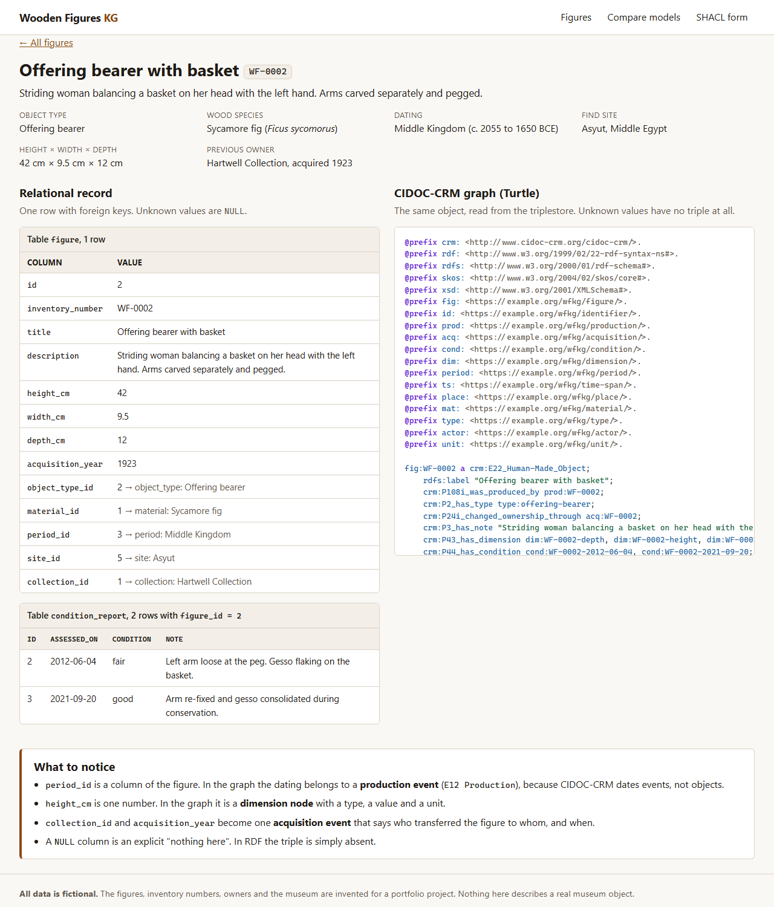
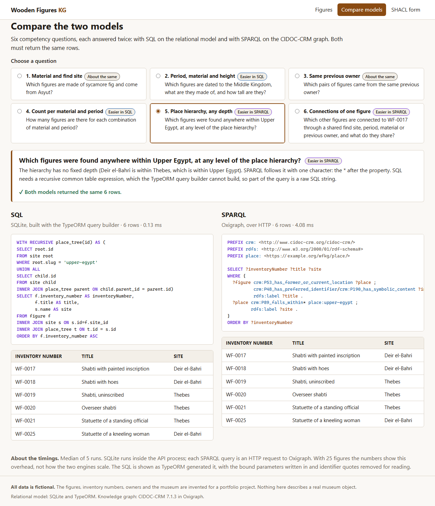
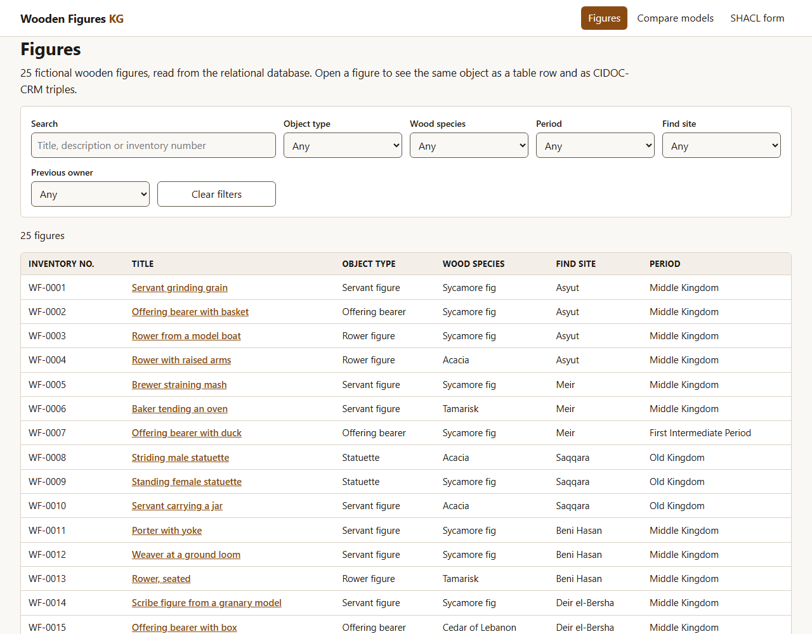
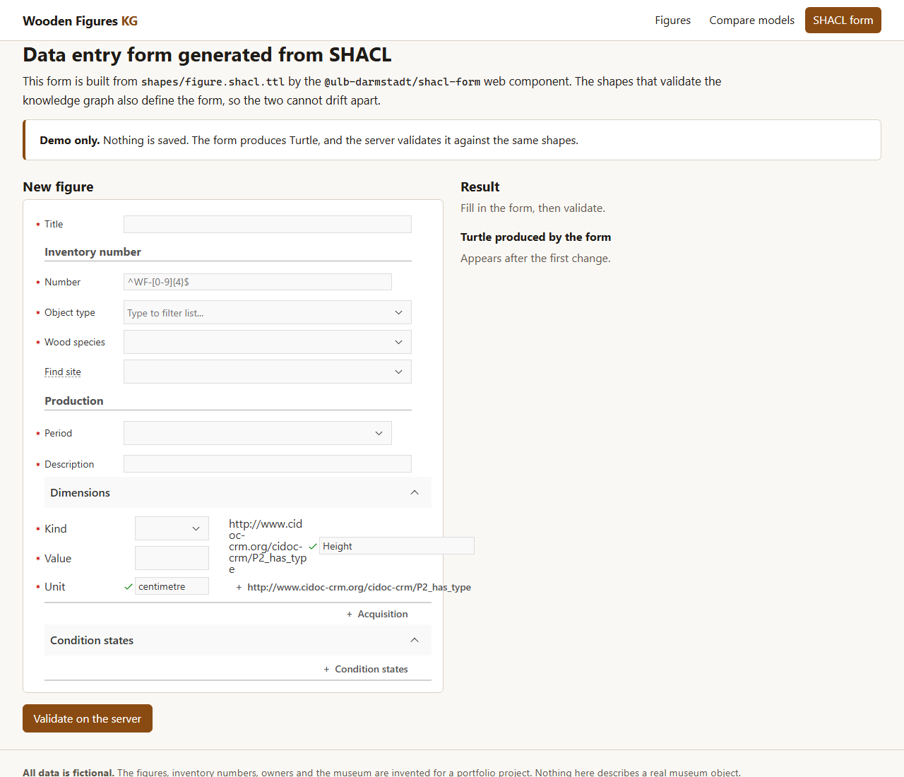
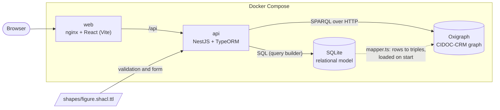
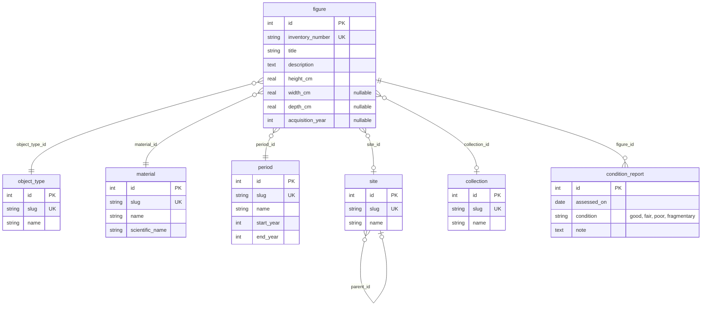
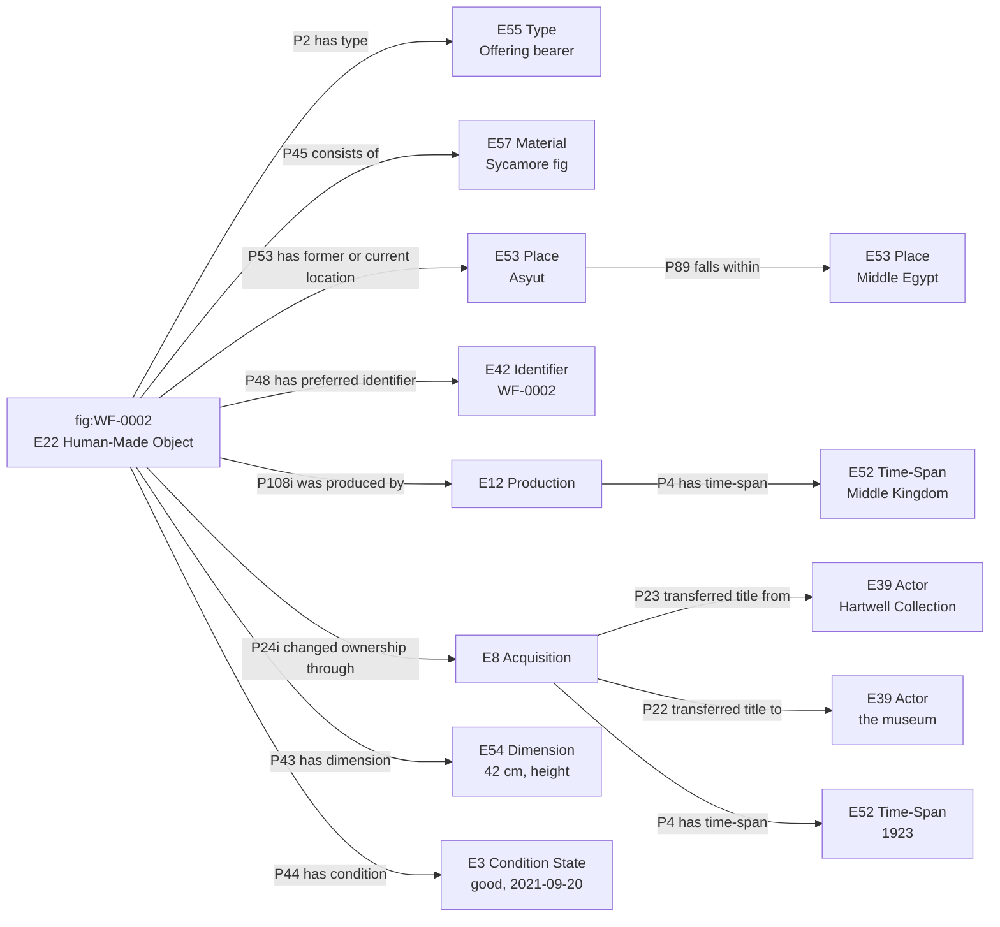

# wooden-figures-kg

The same museum data set modelled twice, as a **relational database** and as a
**CIDOC-CRM knowledge graph**, with an engine that asks both models the same
questions and compares the answers.

The subject is a small collection of ancient wooden figures (servant figures,
shabtis, statuettes). The data models are the core of the project. The web UI
only presents them.

> **All data is fictional.** The 25 figures, their inventory numbers,
> measurements, condition reports, previous owners and the museum itself are
> invented for this project. Nothing here describes a real museum object. Only
> the vocabularies use real-world terms (wood species, object types, Egyptian
> place names, names of historical periods). The period dates are conventional
> approximate dates; published chronologies differ, most of all on where the Old
> Kingdom ends.

## What it shows

| Topic | Where |
| --- | --- |
| Normalised relational schema with foreign keys, CHECK constraints and a migration | [`apps/api/src/database`](apps/api/src/database) |
| Mapping to CIDOC-CRM 7.1.3 (event-centric: production, acquisition) | [`apps/api/src/rdf/mapper.ts`](apps/api/src/rdf/mapper.ts), [docs/mapping.md](docs/mapping.md) |
| SHACL shapes as the constraints of the graph | [`shapes/figure.shacl.ttl`](shapes/figure.shacl.ttl) |
| Six competency questions in SQL and in SPARQL | [`apps/api/src/compare/questions.ts`](apps/api/src/compare/questions.ts) |
| An honest evaluation of both models | [docs/comparison.md](docs/comparison.md) |
| Every design decision, with the alternatives | [docs/decisions.md](docs/decisions.md) |

## Screenshots

**One figure as a table row and as CIDOC-CRM triples**



**One question answered in SQL and in SPARQL**



| Figure browser with filters | Data entry form generated from the SHACL shapes |
| --- | --- |
|  |  |

## Run it

Requirements: Docker with Docker Compose.

```bash
docker compose up --build
```

| URL | What |
| --- | --- |
| <http://localhost:8080> | Web UI |
| <http://localhost:3000/api/figures> | REST API |
| <http://localhost:7878> | Oxigraph (SPARQL endpoint and query editor) |

On start the API creates the SQLite database, inserts the fictional data,
converts it to CIDOC-CRM and loads it into Oxigraph. Nothing else to set up.
To change the ports, copy `.env.example` to `.env`.

Stop and remove everything, including the database volume:

```bash
docker compose down -v
```

## Architecture



SQLite is the single source of truth. The graph is derived from it by one
mapping function, so the two models always describe the same facts and their
query results can be compared row by row.

### The relational model



### The same figure in CIDOC-CRM



The full column by column mapping is in [docs/mapping.md](docs/mapping.md).

## The competency questions

| # | Question | SQL needs | SPARQL needs | Easier in |
| --- | --- | --- | --- | --- |
| 1 | Figures made of sycamore fig from Asyut | 2 joins | 2 triple patterns | about the same |
| 2 | Middle Kingdom figures with material and height | 2 joins, 1 column | event path and a dimension node | SQL |
| 3 | Pairs of figures with the same previous owner | self-join | one variable used twice | about the same |
| 4 | Number of figures per material and period | `GROUP BY` | `GROUP BY` | SQL |
| 5 | Figures found anywhere within Upper Egypt | recursive CTE (raw SQL) | property path `P89_falls_within*` | SPARQL |
| 6 | Figures connected to WF-0017 through a shared site, period, material or owner | four queries with `UNION ALL` | one pattern with alternative paths | SPARQL |

`GET /api/compare/cq5` returns both queries, both result sets, the timings and
whether the rows are identical. For all six questions they are, and a test
checks it.

## API

| Method and path | Returns |
| --- | --- |
| `GET /api/figures?material=&objectType=&period=&site=&collection=&q=` | Figures, filtered by vocabulary slugs and free text |
| `GET /api/figures/:inventoryNumber` | One figure with its related rows |
| `GET /api/figures/:inventoryNumber/rdf` | The same figure as Turtle, read from Oxigraph |
| `GET /api/vocab` and `GET /api/vocab/:name` | Vocabularies: `materials`, `objectTypes`, `periods`, `sites`, `collections` |
| `GET /api/compare` | The list of competency questions |
| `GET /api/compare/:questionId` | SQL and SPARQL queries, results, timings (`cq1` to `cq6`) |
| `GET /api/rdf/export` | The whole data set as Turtle |
| `GET /api/rdf/shapes` | The SHACL shapes |
| `POST /api/rdf/validate` with `{"turtle": "..."}` | A SHACL validation report (nothing is stored) |

## Develop locally

Requirements: Node.js 22.12 or newer, and Docker for Oxigraph.

```bash
npm install
docker compose up -d oxigraph   # the triplestore
npm run dev:api                 # API on http://localhost:3000
npm run dev:web                 # UI on http://localhost:5173 (second terminal)
```

Useful scripts, all run from the repository root:

| Command | What it does |
| --- | --- |
| `npm test` | API unit tests (Node test runner) |
| `npm run seed` | Creates and seeds `data/figures.sqlite` |
| `npm run rdf:export` | Writes the CIDOC-CRM export to `data/figures.ttl` |
| `npm run rdf:validate` | Validates the export against the SHACL shapes |
| `npm run rdf:load` | Loads the export into Oxigraph |
| `npm run e2e` | Cypress end-to-end tests against `http://localhost:5173` |

### Tests

- **API, 70 tests** (`npm test`): the relational constraints, the mapping, the
  SHACL shapes (including data that must be rejected), every CIDOC-CRM term
  against the official RDFS file, and the six questions. The tests that compare
  SQL with SPARQL need Oxigraph and are skipped when it is not running.
- **UI, 3 Cypress specs** (`npm run e2e`): the figure browser and detail page,
  the comparison page, and the SHACL form. They need the full stack. To run them
  against Docker Compose instead of the dev servers:

  ```bash
  CYPRESS_BASE_URL=http://localhost:8080 npm run e2e
  ```

If Cypress fails with `bad option: --smoke-test`, the environment variable
`ELECTRON_RUN_AS_NODE` is set in your shell (some editor terminals do this).
Unset it and run again.

## Project structure

```text
apps/
  api/                    NestJS API (TypeScript, ES modules)
    src/database/         entities, migration, fictional seed data
    src/figures/, vocab/  REST endpoints for the relational model
    src/rdf/              CIDOC-CRM mapper, SPARQL client, SHACL validation
    src/compare/          the six questions and the comparison engine
    src/scripts/          seed, rdf:export, rdf:load, rdf:validate
  web/                    React UI (Vite), Cypress tests
shapes/figure.shacl.ttl   SHACL shapes
vocab/                    official CIDOC-CRM 7.1.3 RDFS, used by a test
docs/                     mapping, comparison, decisions
docker-compose.yml
```

## Documentation

- [docs/mapping.md](docs/mapping.md): every relational column and its CIDOC-CRM class or property, with a reason
- [docs/comparison.md](docs/comparison.md): relational versus semantic model for this data
- [docs/decisions.md](docs/decisions.md): the design decisions and their alternatives

## Licence

Code: [MIT](LICENSE). The file in `vocab/` is the unchanged CIDOC-CRM RDFS,
published by the CIDOC CRM Special Interest Group under CC BY 4.0.
